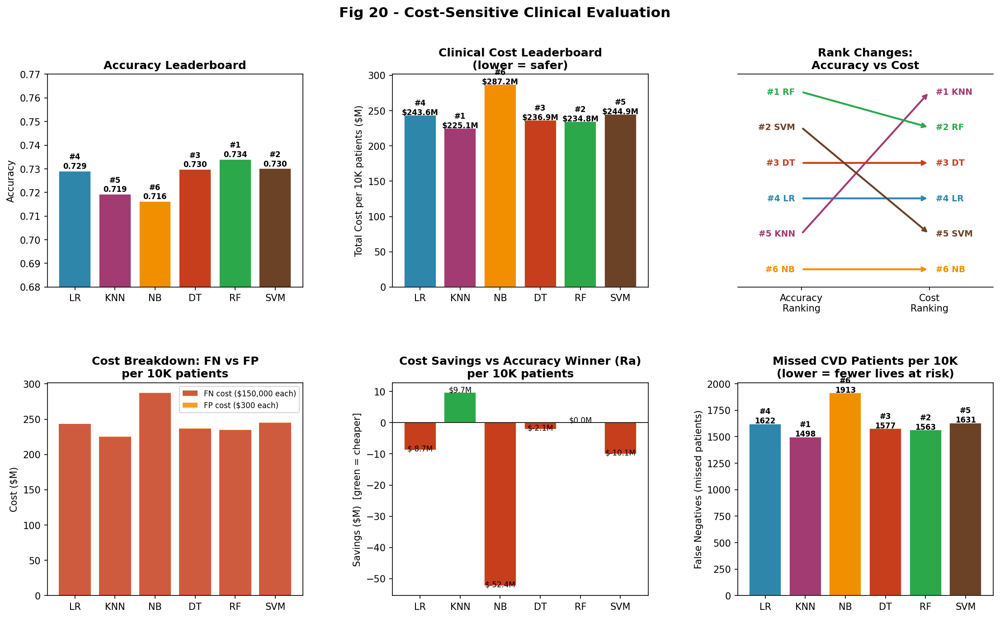
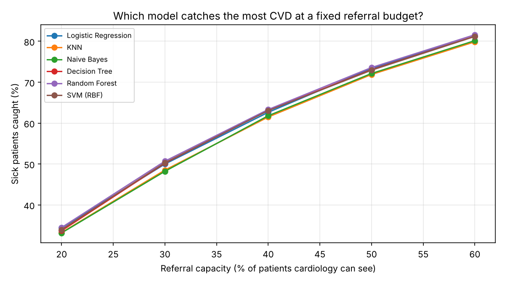
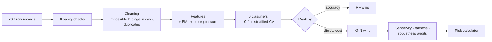

<div align="center">

# Beyond Accuracy

**Choosing a heart-disease classifier by what its mistakes actually cost**


</div>

> **TL;DR:** At the default 0.5 threshold, KNN looked like the cheapest model despite ranking 5th on accuracy. Following the 500:1 cost ratio through changed that conclusion twice. **(1)** Under those costs the cost-minimising rule is "refer if risk > 0.2%", which means refer almost everyone: about **$1.5M per 10,000 patients**, against $225M for the best model at 0.5. **(2)** The realistic question is a referral budget. When cardiology can see a fixed 40% of patients, **Random Forest catches the most sick patients (63.3%) and KNN the fewest (61.5%)**. KNN's earlier "win" came from referring more people, not from ranking risk better. The lesson: the operating point matters more than the choice of model.

<br>

## The problem

A primary-care doctor has about 15 minutes to decide whether to refer a patient to a cardiologist or send them home. The two possible mistakes are not equal:

| Mistake | What happens | Estimated cost |
|:--|:--|--:|
| **False negative** | Sick patient sent home; possible heart attack, ER visit, surgery | **$150,000** |
| **False positive** | Healthy patient gets an unnecessary referral | **$300** |

That's a **500 : 1** asymmetry. Accuracy treats both errors the same, which makes it the wrong way to pick a model here.

## Results

### Step 1: ranking models at the default 0.5 threshold (phase 6)

All figures are per 10,000 patients at the **dataset's prevalence of 49.5%**, which is far above what a primary-care practice sees.

| Model | Accuracy | AUC | Recall | Missed / 10K | **Cost / 10K** | Accuracy rank → **Cost rank** |
|:--|--:|--:|--:|--:|--:|:-:|
| Random Forest | **0.734** | **0.801** | 0.684 | 1,563 | $234.8M | #1 → #2 |
| SVM (RBF) | 0.730 | 0.789 | 0.670 | 1,631 | $244.9M | #2 → #5 |
| Decision Tree | 0.730 | 0.790 | 0.681 | 1,577 | $236.9M | #3 → #3 |
| Logistic Regression | 0.729 | 0.793 | 0.672 | 1,622 | $243.6M | #4 → #4 |
| **KNN** | 0.719 | 0.774 | **0.697** | **1,498** | **$225.1M** | #5 → **#1** |
| Naive Bayes | 0.716 | 0.781 | 0.613 | 1,913 | $287.2M | #6 → #6 |

<p align="center"></p>

### Step 2: the threshold the costs actually imply (phase 10)

With a $300 false positive and a $150,000 false negative, a patient should be referred whenever P(CVD) > 300 / 150,300 ≈ **0.2%**. Applied to the test set:

| Policy | Patients referred | Missed / 10K | Cost / 10K |
|:--|--:|--:|--:|
| Refer nobody | 0% | 4,948 | $742.2M |
| Best model at 0.5 (KNN) | 48% | 1,498 | $225.1M |
| **Refer everybody** | 100% | 0 | **$1.5M** |
| Any model at the cost-optimal threshold | 96–100% | 0–60 | $1.5M–$10.4M |

So under these costs, ranking models at 0.5 compares policies that are all about 150× worse than referring everyone. The cost ratio only produces a useful model once capacity is limited.

### Step 3: a fixed referral budget (phase 10)

A clinic that can refer only a fixed share of patients should send the highest-risk ones. Each model refers exactly that many patients (ties broken at random), so this compares how well each model *ranks* risk.

| Sick patients missed per 10K | 20% capacity | 30% | **40%** | 50% | 60% |
|:--|--:|--:|--:|--:|--:|
| **Random Forest** | **3,243** | **2,440** | **1,815** | **1,307** | **910** |
| Decision Tree | 3,281 | 2,464 | 1,825 | 1,333 | 928 |
| SVM (RBF) | 3,267 | 2,459 | 1,829 | 1,339 | 931 |
| Logistic Regression | 3,246 | 2,475 | 1,849 | 1,318 | 928 |
| Naive Bayes | 3,308 | 2,563 | 1,890 | 1,379 | 982 |
| KNN | 3,303 | 2,548 | 1,905 | 1,391 | 996 |

<p align="center"></p>

The models differ by only 2–5% at any budget, and Random Forest misses the fewest at every capacity. At an illustrative 10% primary-care prevalence the ordering holds, but every count shrinks: Random Forest misses 367 per 10K at 40% capacity (`results/capacity_analysis.csv`). This is the same problem as approving loans under a fixed lending budget. You rank applicants by risk and pick a cut-off that fits the budget.

**Other findings**
- **3 features are enough.** Blood pressure, cholesterol and age recover 99.5% of full-model accuracy, which suits a 15-minute visit.
- **Fair by equal opportunity.** The audit compares recall (sick patients caught) for women and men. At 0.5, all six models have a recall gap under 5 points (phase 8). At the 40% capacity operating point the gap is under 1 point, and the ratio of referral rates between genders is 0.97 or higher, comfortably above the 0.8 "four-fifths" rule used in fair-lending reviews (`results/capacity_fairness.csv`).
- **Robust.** Five of six models hold up under 20% measurement noise (the decision tree doesn't).

## How it works



| Step | Script |
|:--|:--|
| Load and inspect (found a BP of 16,020 mmHg and heights of 250 cm) | `phase1_loading.py` |
| Clean and engineer features | `phase2_cleaning.py`, `phase4_features.py` |
| Exploratory analysis | `phase3_eda.py` |
| Train and compare 6 models | `phase5a_models.py`, `phase5b_viz.py` |
| Cost re-ranking and sensitivity | `phase6_cost.py` |
| Minimal feature set | `phase7_features.py` |
| Fairness and robustness audit | `phase8_fairness.py` |
| Interactive risk calculator | `phase9_calculator.py`, `live_calculator.py` |
| Cost-optimal threshold, referral capacity, prevalence, fairness at the new operating point | `phase10_thresholds.py` |
| Shared cleaning plus data-quality tests (the sanity checks as assertions) | `cvd_data.py`, `tests/` |

## Quickstart

```bash
pip install -r requirements.txt
# Download cardio_train.csv (Kaggle: "Cardiovascular Disease dataset" by Sulianova) into this folder
for p in phase*.py; do python "$p"; done
python live_calculator.py          # score your own patient
pytest -q                          # data-quality checks
```

## What I'd do next

- **Calibrated probabilities** (isotonic or Platt) so the calculator's risk bands can be trusted.
- **Uncertainty on the capacity ranking.** The gaps between models are small, so a bootstrap over test patients would show which differences are real.
- **Real cost data.** The $150K false-negative cost is an estimate; claims data would make the analysis defensible.

<br>

<sub>📄 Full write-up: <a href="report/CVD_Project_Report.pdf">report/CVD_Project_Report.pdf</a> · Boston University MET CS 577, Data Science with Python, Spring 2026</sub>
